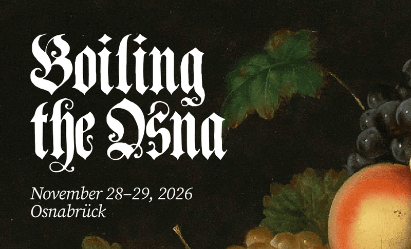

Am 28. und 29. November 2026 kommt Boiling The Ocean nach Osnabrück. Sonst findet das Event in Berlin statt. Diesmal ist es also näher für alle, die in Osnabrück und der Region wohnen.

Mit dabei sind unter anderem GNOME-Designer:innen, Leute aus dem Bazaar-Team sowie Maintainer:innen von Flatpak und Wayland. Inhaltlich geht es um freie Software und langfristige Fragen dazu. Eigene Themen sind willkommen, die Sessions gestalten wir gemeinsam.

[Alle Infos und Anmeldung stehen im Pad.](https://pad.gnome.org/kmlUiUh2RvG2PjCvnCsRsA)
