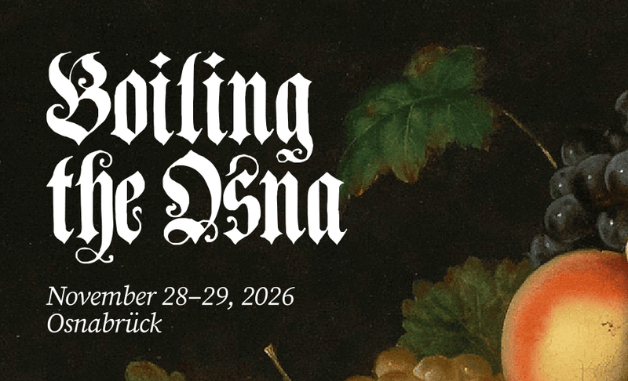

On 28 and 29 November 2026, Boiling The Ocean is coming to Osnabrück. The event usually takes place in Berlin, so this time it's closer for everyone living in Osnabrück and the surrounding region.

Participants include GNOME designers, people from the Bazaar team, and Flatpak and Wayland maintainers. We'll discuss free software and the long-term questions surrounding it. You're welcome to bring your own topics, and we'll shape the sessions together.

[Find all the details and register in the pad.](https://pad.gnome.org/kmlUiUh2RvG2PjCvnCsRsA)
